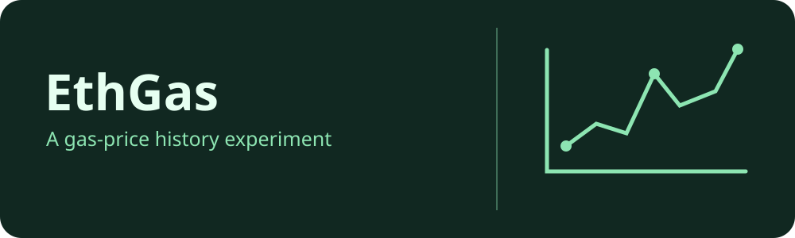

# EthGas

A small historical Ethereum gas-price dashboard. It stores observations in SQLite and serves a chart and JSON endpoints for browsing them.

## Table of Contents

- [Overview](#overview)
- [Technologies](#technologies)
- [Getting Started](#getting-started)

## Overview

The web interface serves the dashboard and a streaming chart. The background updater writes observations to a local store. This project displays fee data; it does not place trades.

## Technologies

- [Flask](https://flask.palletsprojects.com/)
- [Waitress](https://docs.pylonsproject.org/projects/waitress/en/stable/)
- [SQLite](https://www.sqlite.org/)
- [APScheduler](https://apscheduler.readthedocs.io/)

## Getting Started

Start reading at [`web_interface.py`](web_interface.py) and [`gas_table.py`](gas_table.py). Current upstream data availability and runtime setup have not been verified. The launcher binds to all interfaces; don't expose the legacy service without review.
